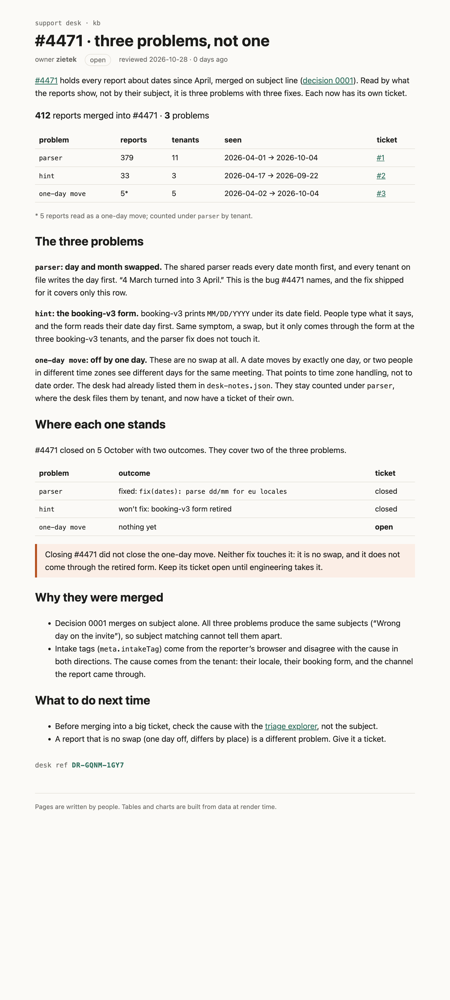

# #4471 · three problems, not one

Support ticket #4471 merged 412 date reports as one issue. They are three problems:

| problem | reports | ticket |
| --- | --- | --- |
| `parser`: shared parser reads dates month first | 379 | [#1](https://github.com/zietek/mega-what-it-shows/issues/1) (closed, fixed) |
| `hint`: booking-v3 form hints MM/DD/YYYY, reads day first | 33 | [#2](https://github.com/zietek/mega-what-it-shows/issues/2) (closed, won't fix) |
| `one-day move`: dates shift by one day across time zones | 5, counted under `parser` | [#3](https://github.com/zietek/mega-what-it-shows/issues/3) (open) |

## The kb page

- The .svx: [`src/routes/kb/incidents/4471-split/+page.svx`](src/routes/kb/incidents/4471-split/+page.svx)
- The page as the desk will see it: [`4471-split.png`](4471-split.png) · [`4471-split.html`](4471-split.html)
- Signed with the course ticket · desk ref **DR-GQNM-1GY7**

The kb at the repo root is the desk's export plus this page and `src/lib/kb/ProblemTable.svelte`. Build: `npm install && npm run build`.
